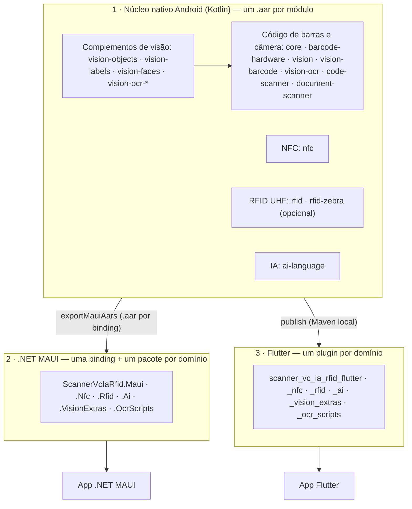

# scanner-vc-ia-rfid

**Biblioteca Universal de Captura de Dados.**

O `ScannerVcIaRfid` reúne, sob uma API nativa em Kotlin, as formas de capturar dados num aparelho Android corporativo:

- **Código de barras por hardware** — coletores Zebra (DataWedge), Datalogic, Honeywell, Newland, Urovo e qualquer leitor que envie a leitura por Intent. Inclui gatilho por software e configuração de simbologias.
- **Câmera e visão computacional** — CameraX + Google ML Kit: código de barras, OCR (latino, chinês, japonês, coreano e devanágari), objetos, rótulos de imagem e rostos. Também o Google Code Scanner e o Google Document Scanner (Play Services).
- **NFC / RFID HF** — leitura e gravação NDEF com o Reader Mode do Android.
- **RFID UHF** — inventário em lotes pelo DataWedge da Zebra ou pelo SDK Zebra RFID API3 (com operações por tag: memória, lock, kill, localização, potência, filtro e bateria).
- **IA de linguagem on-device** — identificação de idioma, tradução e extração de entidades (ML Kit).

O app não precisa saber qual fabricante está por trás do coletor, nem lidar com CameraX, ML Kit ou SDKs de fabricante. Cada recurso é um módulo Gradle publicado como `.aar` independente: o app leva só o que usar. Os módulos são consumidos de forma nativa, via **.NET MAUI** (Android Binding Library) ou via **Flutter** (Platform Channels), sempre com um pacote por domínio.

> [!NOTE]
> Plataforma: só Android. Os pacotes MAUI usam `net10.0-android`, e os plugins Flutter só têm implementação Android.

---

## Sumário

- [Arquitetura do Projeto (A Tríade)](#arquitetura-do-projeto-a-tríade)
  - [Módulos nativos](#módulos-nativos)
  - [Camada Nativa (Kotlin)](#1-camada-nativa-kotlin)
  - [Camada .NET MAUI](#2-camada-net-maui-android-binding-library)
  - [Camada Flutter](#3-camada-flutter-plugin)
- [Estrutura do repositório](#estrutura-do-repositório)
- [Build dos módulos nativos](#build-dos-módulos-nativos)
- [Pacotes por domínio](#pacotes-por-domínio)
- [Apps de exemplo](#apps-de-exemplo)
- [Guia rápido de integração](#guia-rápido-de-integração)
  - [Permissão de câmera](#permissão-de-câmera)
  - [MAUI](#maui)
  - [Flutter](#flutter)
  - [NFC](#nfc)
  - [RFID UHF](#rfid-uhf)
  - [IA de linguagem](#ia-de-linguagem)
  - [Motores extras de visão](#motores-extras-de-visão)
  - [OCR em chinês, japonês, coreano e devanágari](#ocr-em-chinês-japonês-coreano-e-devanágari)
- [Origem dos dados de leitura (`sourceEngine`)](#origem-dos-dados-de-leitura-sourceengine)
- [Configuração dos coletores físicos](#configuração-dos-coletores-físicos)
  - [Gatilho por software e simbologias](#gatilho-por-software-e-simbologias)
- [Requisitos](#requisitos)

---

## Arquitetura do Projeto (A Tríade)



### Módulos nativos

| Módulo (`com.scannervciarfid:<módulo>`) | Conteúdo | Depende de |
|---|---|---|
| `core` | `ScanResult`, `ScannerListener`, `UniversalScanner` | — |
| `barcode-hardware` | `HardwareScannerFactory`, adapters Zebra, Datalogic, Honeywell, Newland, Urovo e Intent genérico | `core` |
| `vision` | `VisionScannerView` (CameraX), `VisionEngineAnalyzer`, `VisionEngineRegistry`, overlay | `core`, CameraX |
| `vision-barcode` | `BarcodeEngine` (id `"barcode"`) | `vision`, ML Kit Barcode |
| `vision-ocr` | `OcrTextEngine` (id `"ocr"`) | `vision`, ML Kit Text Recognition |
| `code-scanner` | `GoogleCodeScanner` (leitura única, sem permissão de câmera) | `core`, Google Play Services |
| `document-scanner` | `GoogleDocumentScanner` (recorte, perspectiva, JPEG e PDF) | Google Play Services |
| `nfc` | `NfcTagReader` (Reader Mode: UID, tecnologias, leitura e gravação NDEF) | — (só `android.nfc`) |
| `rfid` | `RfidReader`, `RfidTagBuffer` (lotes), `ZebraDataWedgeRfidReader`, `RfidReaderFactory` | AndroidX Core |
| `rfid-zebra` (opcional) | `ZebraApi3RfidReader` (SDK Zebra RFID API3) — **minSdk 29**, só entra no build com o SDK em `libs/` | `rfid`, SDK Zebra (`compileOnly`), LocalBroadcastManager |
| `ai-language` | `LanguageAiClient` (idioma, tradução, extração de entidades) — **minSdk 26** | ML Kit Language ID, Translate, Entity Extraction |
| `vision-objects` | `ObjectDetectionEngine` (id `"objects"`) | `vision`, ML Kit Object Detection |
| `vision-labels` | `ImageLabelingEngine` (id `"labels"`) | `vision`, ML Kit Image Labeling |
| `vision-faces` | `FaceDetectionEngine` (id `"faces"`) | `vision`, ML Kit Face Detection |
| `vision-ocr-chinese`, `-japanese`, `-korean`, `-devanagari` | `ChineseOcrEngine`... (ids `"ocr-chinese"`, `"ocr-japanese"`, `"ocr-korean"`, `"ocr-devanagari"`) | `vision-ocr`, ML Kit Text Recognition do script |

Cada domínio entra como um módulo próprio. Os módulos de código de barras e câmera dependem de `core` (`ScanResult`); `nfc`, `rfid` e `ai-language` têm contratos próprios e não dependem de `core`. O módulo `vision` não conhece os motores: cada motor se registra no `VisionEngineRegistry` (ex.: `BarcodeEngine.register()`), e as pontes escolhem o motor pelo id. Recursos opcionais do leitor (operações RFID por tag, gatilho por software, simbologias) ficam em interfaces separadas (`RfidTagOperations`, `SoftTriggerScanner`, `SymbologyConfigurableScanner`): as pontes testam se o leitor do aparelho as implementa.

### 1. Camada Nativa (Kotlin)

Os módulos nativos são o único lugar do ecossistema que conhece hardware de verdade. Duas decisões de design sustentam tudo o que vem depois:

**SDKs proprietários como `compileOnly`.** Os SDKs da Zebra (EMDK) e da Datalogic são declarados assim no `build.gradle.kts` do módulo `barcode-hardware`:

```kotlin
compileOnly(files(rootProject.file("libs/EMDK.jar")))
compileOnly(files(rootProject.file("libs/DatalogicSDK.jar")))
```

Esses `.jar` já existem no firmware dos coletores físicos — declará-los como `implementation` embarcaria binários redundantes no `.aar`, inflando o pacote e arriscando conflito de classes com a versão que o próprio aparelho carrega. Na prática, nem é preciso tocar diretamente nessas APIs proprietárias: os adapters de hardware escutam apenas o resultado da leitura via `BroadcastReceiver`/Intents padrão do Android (perfis DataWedge, Intent Wedge da Datalogic, Intent API da Honeywell...).

O SDK Zebra RFID API3 (módulo `rfid-zebra`) segue a mesma regra por outro motivo: a licença da Zebra não permite publicá-lo junto com a biblioteca. O app adiciona o SDK por conta própria (ver [RFID UHF](#rfid-uhf)).

**API pública sem recursos exclusivos do Kotlin.** `ScannerListener`, `UniversalScanner`, `ScanResult` e `VisionEngineProvider` são, propositalmente, Kotlin "sem açúcar": interfaces com métodos tradicionais (`onScanSuccess`/`onScanError`) em vez de `Flow`, nenhuma `suspend fun` pública, nenhuma `inline fun` ou lambda complexo na assinatura pública, e um `data class` com propriedades `String` simples. Geradores de binding (o `class-parse` do .NET Android SDK, o Platform Channel do Flutter) interpretam interfaces e enums Java/Kotlin clássicos sem problema — mas não sabem o que fazer com corrotinas. Restringir a API pública a listeners e classes de dados primitivas é o que permite o **mesmo** `.aar` virar consumível, de forma idêntica, por C# e por Dart. Resultados estruturados (OCR, NDEF, entidades, objetos) viajam como JSON numa `String`, e as pontes convertem para modelos C#/Dart.

### 2. Camada .NET MAUI (Android Binding Library)

O binding traduz o `.aar` em tipos C# (`Com.Scannervciarfid.*`), e a camada `ScannerVcIaRfid.Maui` empacota isso em abstrações idiomáticas:

- **`ScannerListenerWrapper`** — herda `Java.Lang.Object` e implementa `IScannerListener` (gerado a partir de `ScannerListener`), traduzindo os callbacks JNI em `EventHandler<ScanResultEventArgs>`/`EventHandler<ScanErrorEventArgs>` usando POCOs puros. Nada acima dele precisa referenciar tipos Java.
- **`IHardwareScannerService`** — interface cross-platform injetada via DI como `Singleton` (o leitor físico é um recurso global do aparelho, não algo por-página). A implementação Android (`HardwareScannerService`) é **idempotente** em `Initialize()` — proteção necessária porque `OnAppearing()` pode rodar várias vezes ao longo da vida da página, e registrar o `BroadcastReceiver` nativo duas vezes sem `Release()` no meio derruba o app.
- **`VisionScanner.Engine`** — `BindableProperty` com o id do motor (`VisionEngines.Barcode`, `VisionEngines.Ocr`). O `PropertyMapper` busca o motor no `VisionEngineRegistry` nativo e o aplica na view. A troca funciona com a câmera ligada.
- **Um pacote por domínio** — `ScannerVcIaRfid.Maui` (código de barras, câmera, documentos), `.Nfc`, `.Rfid`, `.Ai`, `.VisionExtras` e `.OcrScripts`, cada um com a própria binding (`ScannerVcIaRfid.<Domínio>.Android.Binding`). Cada serviço segue o mesmo padrão: um wrapper `Java.Lang.Object` traduz os callbacks JNI em eventos .NET ou `Task`, e os modelos expostos são POCOs.
- **Capacidades opcionais** — o factory nativo devolve o leitor pela interface base (ex.: `IRfidReader`). Um cast C# comum falha num objeto Java; os serviços usam `JavaCast<T>()` para saber se o leitor também implementa `IRfidTagOperations`, `ISoftTriggerScanner` ou `ISymbologyConfigurableScanner`.
- **`VisionScannerHandler` + `CommandMapper` (Strict Gating)** — o `ConnectHandler()` do handler **não** inicia a câmera automaticamente. `VisionScanner.StartCamera()` apenas invoca `Handler?.Invoke(nameof(StartCamera))`; um `CommandMapper<VisionScanner, VisionScannerHandler>` estático intercepta esse comando e só então chama `PlatformView.StartCamera()`. Isso elimina a condição de corrida entre o bind do CameraX e o diálogo assíncrono de permissão do usuário — a câmera só liga quando o app explicitamente mandar, depois de confirmar a permissão.

### 3. Camada Flutter (Plugin)

O plugin (`scanner_vc_ia_rfid_flutter`) expõe as duas mesmas vias através dos dois mecanismos de comunicação canônicos do Flutter:

- **`EventChannel` para o hardware** — `HardwareScannerStreamHandler` inicializa e liga o `UniversalScanner` nativo em `onListen`, convertendo cada `ScanResult` em `Map<String, String>` e emitindo via `events.success(...)`. `onCancel` só chama `stop()` (não `release()`) — o leitor físico só é de fato liberado quando o plugin inteiro é desanexado do engine, não a cada vez que a tela Dart para de escutar o stream.
- **`PlatformView` com instâncias isoladas por `viewId`** — cada `AndroidView` no lado Dart gera uma instância própria de `VisionScannerPlatformView`, com seu próprio `MethodChannel` nomeado `"<view_type>_<viewId>"`. Isso evita que múltiplas câmeras simultâneas na mesma árvore de widgets cruzem eventos entre si — cada preview só recebe os comandos (`startCamera`, `setEngine`) e callbacks (`onScanSuccess`/`onScanError`) da sua própria instância nativa.
- **Motor por id** — `VisionScannerWidget(engine: VisionEngines.ocr)` envia o id nos `creationParams`. Mudar `engine` depois chama `setEngine`, sem recriar a câmera.
- **Dependências via Maven** — o `android/build.gradle` do plugin lê os módulos do repositório Maven gerado por `./gradlew publish`. O POM de cada módulo traz CameraX e ML Kit de forma transitiva.
- **Um plugin por domínio** — `scanner_vc_ia_rfid_flutter` (código de barras, câmera, documentos), `_nfc`, `_rfid`, `_ai`, `_vision_extras` e `_ocr_scripts`. Os plugins complementares de visão só registram motores no `VisionEngineRegistry` nativo: basta estar no `pubspec.yaml` para o `VisionScannerWidget` aceitar os ids novos.
- **`ActivityAware` quando precisa** — o Code Scanner, o Document Scanner e o Reader Mode do NFC exigem a Activity atual; os plugins correspondentes a recebem pelo `ActivityPluginBinding`.

---

## Estrutura do repositório

```
scanner-vc-ia-rfid/
├── build.gradle.kts                       # Raiz: configuração comum, maven-publish, exportMauiAars
├── settings.gradle.kts                    # Lista dos módulos
├── gradle/libs.versions.toml              # Versões compartilhadas (AGP, CameraX, ML Kit)
├── core/                                  # Contratos: ScanResult, ScannerListener, UniversalScanner
├── barcode-hardware/                      # HardwareScannerFactory + adapters de leitor físico
├── vision/                                # VisionScannerView (CameraX) + registro de motores
├── vision-barcode/                        # BarcodeEngine (ML Kit Barcode)
├── vision-ocr/                            # OcrTextEngine (ML Kit Text Recognition)
├── code-scanner/                          # GoogleCodeScanner (Play Services)
├── document-scanner/                      # GoogleDocumentScanner (Play Services)
├── nfc/                                   # NfcTagReader (Reader Mode)
├── rfid/                                  # Contrato RFID UHF + leitor via DataWedge
├── rfid-zebra/                            # Leitor pelo SDK Zebra RFID API3 (opcional)
├── ai-language/                           # IA de linguagem on-device (ML Kit)
├── vision-objects/                        # ObjectDetectionEngine
├── vision-labels/                         # ImageLabelingEngine
├── vision-faces/                          # FaceDetectionEngine
├── vision-ocr-{chinese,japanese,korean,devanagari}/  # OCR por script
├── sample/                                # App Android nativo de exemplo
├── libs/                                  # SDKs proprietários (fora do Git) - ver libs/README.md
│
├── dotnet/                                # Ponte .NET MAUI (uma binding + um pacote por domínio)
│   ├── ScannerVcIaRfid.Android.Binding/              # .aar de código de barras, câmera e documentos
│   ├── ScannerVcIaRfid.Maui/                         # IHardwareScannerService, VisionScanner, Code/Document Scanner
│   ├── ScannerVcIaRfid.Nfc.Android.Binding/ + ScannerVcIaRfid.Maui.Nfc/
│   ├── ScannerVcIaRfid.Rfid.Android.Binding/ + ScannerVcIaRfid.Maui.Rfid/
│   ├── ScannerVcIaRfid.Ai.Android.Binding/ + ScannerVcIaRfid.Maui.Ai/
│   ├── ScannerVcIaRfid.VisionExtras.Android.Binding/ + ScannerVcIaRfid.Maui.VisionExtras/
│   ├── ScannerVcIaRfid.OcrScripts.Android.Binding/ + ScannerVcIaRfid.Maui.OcrScripts/
│   └── ScannerVcIaRfid.Maui.Sample/                  # App de exemplo com todos os pacotes
│
└── flutter/                               # Ponte Flutter (um plugin por domínio)
    ├── scanner_vc_ia_rfid_flutter/          # Código de barras, câmera e documentos
    ├── scanner_vc_ia_rfid_nfc/
    ├── scanner_vc_ia_rfid_rfid/
    ├── scanner_vc_ia_rfid_ai/
    ├── scanner_vc_ia_rfid_vision_extras/
    └── scanner_vc_ia_rfid_ocr_scripts/      # cada plugin: android/, lib/ e example/
```

---

## Build dos módulos nativos

Rode os comandos na raiz do repositório:

1. Gere o repositório Maven local (usado pelo plugin Flutter):

   ```bash
   ./gradlew publish
   ```

   A saída fica em `build/maven-repo`, com um `.aar`, um POM e um `.module` por módulo.

2. Gere os `.aar` para a binding .NET MAUI:

   ```bash
   ./gradlew exportMauiAars
   ```

   A task copia cada `scanner-vc-ia-rfid-<módulo>.aar` para a pasta `Jars/` da binding do seu domínio (ex.: `nfc` vai para `dotnet/ScannerVcIaRfid.Nfc.Android.Binding/Jars/`). O mapa módulo → binding fica em `mauiBindings`, no `build.gradle.kts` da raiz. Módulos condicionais (`rfid-zebra`) só são copiados quando estão no build.

Repita os dois passos sempre que alterar o código Kotlin. A versão publicada fica em `VERSION_NAME` (`gradle.properties`).

## Pacotes por domínio

Cada domínio tem o próprio pacote MAUI (com a própria binding) e o próprio plugin Flutter. O app instala só o que usar.

| Domínio | Módulos nativos | MAUI | Flutter |
|---|---|---|---|
| Código de barras, câmera e documentos | `core`, `barcode-hardware`, `vision`, `vision-barcode`, `vision-ocr`, `code-scanner`, `document-scanner` | `ScannerVcIaRfid.Maui` | `scanner_vc_ia_rfid_flutter` |
| NFC | `nfc` | `ScannerVcIaRfid.Maui.Nfc` | `scanner_vc_ia_rfid_nfc` |
| RFID UHF | `rfid`, `rfid-zebra` (opcional) | `ScannerVcIaRfid.Maui.Rfid` | `scanner_vc_ia_rfid_rfid` |
| IA de linguagem | `ai-language` | `ScannerVcIaRfid.Maui.Ai` | `scanner_vc_ia_rfid_ai` |
| Motores extras de visão (complemento) | `vision-objects`, `vision-labels`, `vision-faces` | `ScannerVcIaRfid.Maui.VisionExtras` | `scanner_vc_ia_rfid_vision_extras` |
| OCR por script (complemento) | `vision-ocr-chinese`, `-japanese`, `-korean`, `-devanagari` | `ScannerVcIaRfid.Maui.OcrScripts` | `scanner_vc_ia_rfid_ocr_scripts` |

## Apps de exemplo

| App | O que mostra |
|---|---|
| [`sample/`](sample) (Android nativo) | Todos os módulos: leitor físico, câmera com todos os motores, Code/Document Scanner, NFC, RFID e IA |
| [`dotnet/ScannerVcIaRfid.Maui.Sample`](dotnet/ScannerVcIaRfid.Maui.Sample) | Todos os pacotes MAUI numa tela |
| [`flutter/scanner_vc_ia_rfid_flutter/example`](flutter/scanner_vc_ia_rfid_flutter/example) | Leitor físico, câmera, Code Scanner, Document Scanner e gatilho por software |
| [`flutter/scanner_vc_ia_rfid_nfc/example`](flutter/scanner_vc_ia_rfid_nfc/example) | Leitura e gravação NFC |
| [`flutter/scanner_vc_ia_rfid_rfid/example`](flutter/scanner_vc_ia_rfid_rfid/example) | Inventário, leitura de TID e localização |
| [`flutter/scanner_vc_ia_rfid_ai/example`](flutter/scanner_vc_ia_rfid_ai/example) | Idioma, entidades e tradução |
| [`flutter/scanner_vc_ia_rfid_vision_extras/example`](flutter/scanner_vc_ia_rfid_vision_extras/example) | Objetos, rótulos e rostos |
| [`flutter/scanner_vc_ia_rfid_ocr_scripts/example`](flutter/scanner_vc_ia_rfid_ocr_scripts/example) | OCR em chinês, japonês, coreano e devanágari |

Os exemplos Flutter versionam só `lib/`, `pubspec.yaml` e o `AndroidManifest.xml`. Para rodar, gere o resto do projeto Android:

1. Entre na pasta `example/` do plugin.
2. Rode `flutter create --platforms=android .` (os arquivos existentes não são sobrescritos).
3. Rode `flutter run`.

O sample nativo e o sample MAUI usam `minSdk` 26 (pacote de IA) ou 29, quando o SDK Zebra RFID API3 está em `libs/`.

## Guia rápido de integração

### Permissão de câmera

O módulo `vision` já declara `android.permission.CAMERA` (com `uses-feature` `required="false"`), e o merge do manifesto leva a declaração para o app. Declarar de novo no app é opcional.

> [!WARNING]
> Peça a permissão de câmera **em tempo de execução**, antes de iniciar a câmera. Os quickstarts abaixo mostram como. Sem o pedido em runtime, o bind do CameraX falha de forma controlada (o núcleo Kotlin captura a `SecurityException` e reporta via `onScanError`), mas a câmera não funciona. O Google Code Scanner e o Google Document Scanner não precisam dessa permissão.

### MAUI

**1. Gere os `.aar`** com `./gradlew exportMauiAars` (ver [Build dos módulos nativos](#build-dos-módulos-nativos)).

**2. Registro em `MauiProgram.cs`:**

```csharp
builder.Services.AddSingleton<IHardwareScannerService, HardwareScannerService>();

builder.ConfigureMauiHandlers(handlers =>
{
    handlers.AddHandler<VisionScanner, VisionScannerHandler>();
});
```

**3. XAML** — `Engine` é opcional (padrão: `barcode`):

```xml
<controls:VisionScanner x:Name="CameraScannerView"
                        Engine="ocr"
                        HeightRequest="300" />
```

**4. Code-behind — permissão em runtime + Strict Gating:**

```csharp
protected override async void OnAppearing()
{
    base.OnAppearing();

    _hardwareScanner.Initialize();
    _hardwareScanner.ScanSucceeded += OnHardwareScanSucceeded;

    var granted = await EnsureCameraPermissionAsync();
    if (granted)
    {
        // A câmera só liga aqui — o Handler nunca inicia sozinho.
        CameraScannerView.StartCamera();
    }
}

private static async Task<bool> EnsureCameraPermissionAsync()
{
    var status = await Permissions.CheckStatusAsync<Permissions.Camera>();
    if (status != PermissionStatus.Granted)
    {
        status = await Permissions.RequestAsync<Permissions.Camera>();
    }
    return status == PermissionStatus.Granted;
}
```

**5. Leitura única com o Google Code Scanner** (opcional, exige Play Services, sem permissão de câmera):

```csharp
builder.Services.AddSingleton<ICodeScannerService, CodeScannerService>();

var result = await _codeScanner.ScanAsync(); // null = usuário cancelou
```

**6. Digitalização de documentos com o Google Document Scanner** (opcional, exige Play Services, sem permissão de câmera). O Google faz a captura, o recorte e a correção de perspectiva:

```csharp
builder.Services.AddSingleton<IDocumentScannerService, DocumentScannerService>();

var document = await _documentScanner.ScanAsync(pageLimit: 5); // null = usuário cancelou
// document.PageImageUris (JPEG por página), document.PdfUri
```

**7. Coletor sem adapter próprio** (Chainway, Sunmi, Seuic...): configure a saída Intent no aparelho e informe a mesma action e o mesmo extra:

```csharp
_hardwareScanner.UseGenericIntent("com.minhaempresa.SCAN", "data");
```

Exemplo completo em [`dotnet/ScannerVcIaRfid.Maui.Sample`](dotnet/ScannerVcIaRfid.Maui.Sample).

### Flutter

**1. Publique os módulos** com `./gradlew publish` (ver [Build dos módulos nativos](#build-dos-módulos-nativos)). O plugin lê `build/maven-repo` deste repositório. Para outro local, defina `scannerVcIaRfidMavenRepo` no `gradle.properties` do app.

**2. Escute o leitor de hardware como um `Stream`:**

```dart
StreamSubscription<ScanResult>? _hardwareSubscription;

@override
void initState() {
  super.initState();
  _hardwareSubscription =
      ScannerVcIaRfidHardware.instance.onBarcodeScanned.listen(_handleScanResult);
}

@override
void dispose() {
  _hardwareSubscription?.cancel();   // evita vazamento de memória
  super.dispose();
}
```

**3. Peça a permissão de câmera antes de construir o widget:**

```dart
final status = await Permission.camera.request();
```

**4. Embuta a câmera nativa — sempre dentro de um container com altura explícita:**

```dart
SizedBox(
  height: 300,
  child: status.isGranted
      ? VisionScannerWidget(
          engine: VisionEngines.barcode, // ou VisionEngines.ocr
          onScan: _handleScanResult,
          onScanError: (message) => debugPrint('Erro: $message'),
        )
      : const Center(child: Text('Permissão de câmera negada.')),
)
```

`PlatformView` não tem tamanho intrínseco no Flutter: sem altura definida, o `AndroidView` renderiza com altura zero.

**5. Leitura única com o Google Code Scanner** (opcional, exige Play Services, sem permissão de câmera):

```dart
final result = await ScannerVcIaRfidCodeScanner.instance.scan(); // null = cancelado
```

**6. Digitalização de documentos com o Google Document Scanner** (opcional, exige Play Services, sem permissão de câmera):

```dart
final document = await ScannerVcIaRfidDocumentScanner.instance.scan(pageLimit: 5); // null = cancelado
// document.pageImageUris (JPEG por página), document.pdfUri
```

**7. Coletor sem adapter próprio** (Chainway, Sunmi, Seuic...): configure a saída Intent no aparelho e informe a mesma action e o mesmo extra:

```dart
await ScannerVcIaRfidHardware.instance.useGenericIntent(
  intentAction: 'com.minhaempresa.SCAN',
  dataExtraKey: 'data',
);
```

Exemplo completo em [`flutter/scanner_vc_ia_rfid_flutter/example`](flutter/scanner_vc_ia_rfid_flutter/example).

---

### NFC

O NFC usa uma permissão normal (sem diálogo em runtime) e só entrega tags com o app em primeiro plano. Cada tag traz o UID em hexadecimal, as tecnologias (`NfcA`, `MifareUltralight`, `Ndef`...) e os registros NDEF, com texto e URI já decodificados.

**MAUI** (`ScannerVcIaRfid.Maui.Nfc`):

```csharp
builder.Services.AddSingleton<INfcService, NfcService>();

// OnAppearing
if (_nfc.IsSupported)
{
    _nfc.TagRead += (s, e) => Debug.WriteLine($"{e.Tag.Uid}: {e.Tag.NdefRecords.FirstOrDefault()?.Text}");
    _nfc.Start();
}

// OnDisappearing
_nfc.Stop();
```

**Flutter** (`scanner_vc_ia_rfid_nfc`):

```dart
_subscription = ScannerVcIaRfidNfc.instance.onTagRead.listen((tag) {
  debugPrint('${tag.uid}: ${tag.ndefRecords.firstOrNull?.text}');
});

// dispose(): cancelar a subscription desliga o Reader Mode.
_subscription?.cancel();
```

#### Gravação NDEF

A gravação é "armada": a próxima tag aproximada recebe a mensagem, em vez de gerar o evento de leitura. Depois disso, a gravação é desarmada. O Reader Mode precisa estar ligado (`Start()` no MAUI, uma subscription de `onTagRead` no Flutter).

- Tipos de registro: Text (UTF-8, com código de idioma) e URI.
- Tag vazia com `NdefFormatable`: a biblioteca formata e grava numa operação só.
- Erros: tag somente leitura, mensagem maior que a capacidade da tag, tag sem suporte a NDEF.

```csharp
var tag = await _nfc.WriteTextAsync("Lote 123");   // _nfc.CancelWrite() desarma
```

```dart
final tag = await ScannerVcIaRfidNfc.instance.writeUri('https://exemplo.com/lote/123');
```

A emulação de cartão (HCE) não está incluída: ela exige um `HostApduService` declarado no manifesto do app, com os AIDs do cartão emulado, e roda sem interface. Ela entra quando houver um caso de uso concreto.

Exemplos em [`dotnet/ScannerVcIaRfid.Maui.Sample`](dotnet/ScannerVcIaRfid.Maui.Sample) e [`flutter/scanner_vc_ia_rfid_nfc/example`](flutter/scanner_vc_ia_rfid_nfc/example).

### RFID UHF

O leitor entrega as tags **em lotes** (`RfidTagBuffer`, janela de 100 ms): cada EPC aparece uma vez por lote, com o número de leituras e o maior RSSI. Para um inventário de tags únicas, guarde os EPCs num conjunto no app.

Existem dois leitores Zebra. O `RfidReaderFactory.create()` escolhe sozinho, e o código do app não muda:

| Leitor | Quando é usado | Entrega |
|---|---|---|
| `ZebraApi3RfidReader` (módulo `rfid-zebra`) | O app tem o módulo `rfid-zebra` e o SDK Zebra RFID API3 | EPC, RSSI e contagem de leituras |
| `ZebraDataWedgeRfidReader` (módulo `rfid`) | Nos outros casos, em aparelhos Zebra | Só o EPC |

**Leitor DataWedge.** Usa o plugin "RFID Input" do DataWedge (MC3300R, RFD40, RFD90, TC53E, EM45, ET6X). Ele divide o perfil DataWedge com o leitor de código de barras e separa as leituras pelo extra `com.symbol.datawedge.source`. O gatilho físico dispara o inventário; `startInventory()`/`stopInventory()` usam o `SOFT_RFID_TRIGGER` (o `STOP_SCANNING` exige DataWedge 11.3+).

**Leitor SDK Zebra RFID API3.** Conecta ao primeiro leitor encontrado, na ordem do sample oficial: `RE_SERIAL` (sled acoplado), `SERVICE_SERIAL` e `QC_SERIAL` (leitor embutido), `SERVICE_USB` e, por último, `BLUETOOTH`. O gatilho físico inicia e para o inventário. Testado só em compilação contra o SDK 2.0.5.297.

O SDK é proprietário: ele não fica no Git e não é publicado com o módulo (`compileOnly`). Para usar:

1. Baixe o "Zebra RFID SDK for Android" no [portal da Zebra](https://www.zebra.com/us/en/support-downloads/software/developer-tools/rfid-sdk-for-android.html) (exige login).
2. Copie `rfidapi3lib-<versão>.aar` para `libs/`, sem renomear. O `rfidapi3ziotcllrplib-<versão>.aar` é para leitores fixos (FX/ZIOTC) e não é usado.
3. Rode `./gradlew publish exportMauiAars`. Com o SDK em `libs/`, o módulo `rfid-zebra` entra no build.
4. Configure o app:
   - `minSdk` 29 (Android 10), exigido pelo SDK.
   - `tools:replace` no `<application>` do `AndroidManifest.xml`: o SDK declara `android:label` e `android:allowBackup`. Substitua os atributos que o app também declara (ex.: `tools:replace="android:allowBackup,android:label"`).
   - Permissão `BLUETOOTH_CONNECT` em runtime, se o leitor for um sled Bluetooth.

> [!WARNING]
> Inclua o `.aar` do SDK no app. O módulo `rfid-zebra` só o usa para compilar. Sem o SDK no app, a fábrica não encontra a classe `com.zebra.rfid.api3.Readers` e volta para o leitor DataWedge.

- **App nativo:** `implementation(project(":rfid-zebra"))` e `implementation(files("libs/rfidapi3lib-<versão>.aar"))` (ver [`sample/build.gradle.kts`](sample/build.gradle.kts)).
- **MAUI:** a binding `ScannerVcIaRfid.Rfid.Android.Binding` inclui o `rfid-zebra` e o SDK de `libs/` (`Bind="false"`) quando eles existem. O app só precisa de `<SupportedOSPlatformVersion>29.0</SupportedOSPlatformVersion>` e do `tools:replace`.
- **Flutter:** defina `scannerVcIaRfidZebraApi3=true` no `android/gradle.properties` do app e adicione o SDK em `android/app/build.gradle.kts`: `implementation(files("<caminho>/rfidapi3lib-<versão>.aar"))`.

#### Operações por tag

O contrato `RfidTagOperations` (módulo `rfid`) cobre as operações que dependem do SDK do fabricante. Hoje só o `ZebraApi3RfidReader` o implementa; o leitor DataWedge só faz inventário. As pontes informam o suporte em `SupportsTagOperations` (MAUI) e `supportsTagOperations()` (Flutter).

| Operação | MAUI (`IRfidReaderService`) | Flutter (`ScannerVcIaRfidRfid`) |
|---|---|---|
| Ler memória (hexadecimal) | `ReadMemoryAsync(epc, bank, wordOffset, wordCount)` | `readMemory(epc, bank:, wordCount:)` |
| Gravar memória | `WriteMemoryAsync(epc, bank, wordOffset, dataHex)` | `writeMemory(epc, bank:, dataHex:)` |
| Lock / unlock / permalock | `LockAsync(epc, field, privilege, accessPassword)` | `lock(epc, field:, privilege:, accessPassword:)` |
| Kill | `KillAsync(epc, killPassword)` | `kill(epc, killPassword:)` |
| Localizar por distância (0 a 100) | `StartLocate(epc)` / `StopLocate()` + evento `TagLocated` | `startLocate(epc)` / `stopLocate()` + stream `onTagLocated` |
| Potência (dBm, nível mais próximo) | `SetTransmitPowerAsync(dbm)` | `setTransmitPower(dbm)` |
| Sessão Gen2 (0 a 3) | `SetSessionAsync(session)` | `setSession(session)` |
| Filtro Select do inventário | `SetInventoryFilterAsync(bank, bitOffset, patternHex)` / `ClearInventoryFilterAsync()` | `setInventoryFilter(bank:, bitOffset:, patternHex:)` / `clearInventoryFilter()` |
| Bateria do leitor (sleds) | `RequestBatteryStatus()` + evento `BatteryStatusChanged` | `requestBatteryStatus()` + stream `onBatteryStatus` |

Regras comuns:

- Pare o inventário antes de uma operação: o leitor não faz as duas coisas ao mesmo tempo. Durante a localização, o gatilho físico não inicia inventário.
- Bancos: `Reserved`, `Epc`, `Tid`, `User`. Offset e tamanho em palavras de 16 bits; dados em hexadecimal (4 dígitos por palavra).
- Senhas: 8 dígitos hexadecimais (`"00000000"` = sem senha).
- A potência usa a tabela de níveis do leitor (`getTransmitPowerLevelValues`, em décimos de dBm) e devolve o valor aplicado.
- Filtro Select: só as tags com o padrão respondem ao inventário. No banco EPC, o EPC começa no bit 32 (depois do CRC e do PC): para filtrar pelo prefixo do EPC, use `bitOffset` 32. O padrão aceita qualquer número de bytes.
- O sled também avisa sozinho quando o nível de bateria muda.

**Permissão Bluetooth (sleds pareados, Android 12+).** Peça `BLUETOOTH_CONNECT` em runtime **antes** de inicializar o leitor. Sem ela, o sled Bluetooth não aparece na busca. Leitores embutidos e por USB não precisam.

- **Nativo:** `RfidPermissions.requiredRuntimePermissions()` lista o que pedir; `hasRuntimePermissions(context)` confere.
- **MAUI:** `await _rfid.RequestBluetoothPermissionAsync()` antes de `Initialize()`. Pede só quando o leitor é o do SDK API3.
- **Flutter:** `requiredBluetoothPermissions()` lista o que pedir; peça com um pacote como `permission_handler` antes de escutar `onTagsRead`.

```csharp
var tid = await _rfid.ReadMemoryAsync(epc, RfidMemoryBank.Tid, wordOffset: 0, wordCount: 6);
```

```dart
final tid = await ScannerVcIaRfidRfid.instance.readMemory(epc, bank: RfidMemoryBank.tid, wordCount: 6);
```

> [!CAUTION]
> Não use `kill`, `PermaLock` nem `PermaUnlock` em teste com tags de produção. Essas operações não têm volta: a tag morta não responde mais, e o bloqueio permanente não pode ser desfeito.

**MAUI** (`ScannerVcIaRfid.Maui.Rfid`):

```csharp
builder.Services.AddSingleton<IRfidReaderService, RfidReaderService>();

if (_rfid.IsAvailable)
{
    _rfid.Initialize();
    _rfid.TagsRead += (s, e) => _inventory.UnionWith(e.Tags.Select(t => t.Epc)); // main thread
    _rfid.StartInventory();
}
```

**Flutter** (`scanner_vc_ia_rfid_rfid`):

```dart
final rfid = ScannerVcIaRfidRfid.instance;
if (await rfid.isAvailable()) {
  _subscription = rfid.onTagsRead.listen((tags) => _inventory.addAll(tags.map((t) => t.epc)));
  await rfid.startInventory();
}
```

Exemplos em [`dotnet/ScannerVcIaRfid.Maui.Sample`](dotnet/ScannerVcIaRfid.Maui.Sample) e [`flutter/scanner_vc_ia_rfid_rfid/example`](flutter/scanner_vc_ia_rfid_rfid/example).

### IA de linguagem

Tudo roda no aparelho, com ML Kit: o texto não sai do coletor e não exige Google Play Services.

- **Identificação de idioma:** modelo embarcado, funciona offline desde a primeira chamada.
- **Tradução:** baixa o modelo de cada idioma (~30 MB) na primeira chamada.
- **Extração de entidades:** encontra datas, endereços, telefones, e-mails, valores, números de rastreio, IBAN, ISBN, cartões e URLs. Baixa o modelo do idioma na primeira chamada. É o par natural do OCR: o texto lido pela câmera vira dados estruturados.

> [!WARNING]
> Defina `minSdk 26` no app que usar este pacote. O ML Kit Entity Extraction exige Android 8.0 (API 26). Sem isso, o merge do manifesto falha. No MAUI, use `<SupportedOSPlatformVersion>26.0</SupportedOSPlatformVersion>`; no Flutter, `minSdk = 26` em `android/app/build.gradle.kts`.

**MAUI** (`ScannerVcIaRfid.Maui.Ai`):

```csharp
builder.Services.AddSingleton<ILanguageAiService, LanguageAiService>();

var language = await _languageAi.IdentifyLanguageAsync(ocrText);            // "pt"
var entities = await _languageAi.ExtractEntitiesAsync(ocrText, language);    // DATE_TIME, PHONE, MONEY...
var english = await _languageAi.TranslateAsync(ocrText, language, "en");
```

**Flutter** (`scanner_vc_ia_rfid_ai`):

```dart
final ai = ScannerVcIaRfidAi.instance;
final entities = await ai.extractEntities(ocrText, languageTag: 'pt');
final english = await ai.translate(ocrText, sourceLanguage: 'pt', targetLanguage: 'en');
```

O binding .NET do Entity Extraction não tem pacote NuGet: a binding `ScannerVcIaRfid.Ai.Android.Binding` baixa o `.aar` do Google Maven com `AndroidMavenLibrary` e declara cada dependência Java dele como `PackageReference`. O aviso XA4301 (`libtextclassifier3_jni_tclib.so` duplicada) é esperado: as cópias vêm do mesmo `.aar`.

Exemplos em [`dotnet/ScannerVcIaRfid.Maui.Sample`](dotnet/ScannerVcIaRfid.Maui.Sample) e [`flutter/scanner_vc_ia_rfid_ai/example`](flutter/scanner_vc_ia_rfid_ai/example).

### Motores extras de visão

Três motores novos para o mesmo controle de câmera (`VisionScanner` / `VisionScannerWidget`). O pacote complementar só registra os motores no `VisionEngineRegistry`; o controle do pacote principal passa a aceitar os ids novos sem nenhuma mudança.

| Id | `format` | `value` (JSON) |
|---|---|---|
| `objects` | `VISION_OBJECTS` | `{"objects": [{trackingId, boundingBox, labels: [{text, confidence}]}]}` — até 5 objetos, categorias grosseiras do modelo padrão |
| `labels` | `VISION_LABELS` | `{"labels": [{text, confidence, index}]}` — rótulos da cena em inglês, confiança ≥ 70% |
| `faces` | `VISION_FACES` | `{"faces": [{trackingId, boundingBox, smilingProbability, leftEyeOpenProbability, rightEyeOpenProbability, headEulerAngleY, headEulerAngleZ}]}` — detecta, não reconhece pessoas |

Os três usam modelos embarcados (sem Play Services) e emitem um resultado só quando o conjunto de itens muda, no máximo uma vez por segundo.

**MAUI** (`ScannerVcIaRfid.Maui.VisionExtras`):

```csharp
builder.UseVisionExtras();

CameraScannerView.Engine = VisionExtraEngines.Objects;
var objects = VisionExtrasPayload.ParseObjects(result.Value).Objects;
```

**Flutter** (`scanner_vc_ia_rfid_vision_extras` — basta estar no `pubspec.yaml`):

```dart
VisionScannerWidget(
  engine: VisionExtraEngines.objects,
  onScan: (result) => print(VisionExtrasPayload.parseObjects(result.value)),
)
```

Exemplos em [`dotnet/ScannerVcIaRfid.Maui.Sample`](dotnet/ScannerVcIaRfid.Maui.Sample) e [`flutter/scanner_vc_ia_rfid_vision_extras/example`](flutter/scanner_vc_ia_rfid_vision_extras/example).

### OCR em chinês, japonês, coreano e devanágari

O OCR padrão (`ocr`) lê alfabetos latinos. Quatro motores complementares leem outros scripts com o mesmo `OcrTextEngine`: o resultado tem o mesmo JSON (`format` `VISION_OCR`, com `fullText` e `blocks`), e cada modelo também lê texto latino.

| Id | Script |
|---|---|
| `ocr-chinese` | Chinês simplificado e tradicional |
| `ocr-japanese` | Japonês |
| `ocr-korean` | Coreano |
| `ocr-devanagari` | Devanágari (hindi, marathi, nepali...) |

Cada script é um módulo nativo próprio (`vision-ocr-<script>`) com um modelo embarcado de alguns MB, sem Play Services. No app nativo, inclua só os scripts que usar. Os pacotes MAUI e Flutter trazem os quatro.

- **Nativo:** `view.setVisionEngine(ChineseOcrEngine.create())`.
- **MAUI** (`ScannerVcIaRfid.Maui.OcrScripts`): `builder.UseOcrScripts();` e `CameraScannerView.Engine = OcrScriptEngines.Chinese;`.
- **Flutter** (`scanner_vc_ia_rfid_ocr_scripts`, basta estar no `pubspec.yaml`): `VisionScannerWidget(engine: OcrScriptEngines.chinese, ...)`.

Exemplo em [`flutter/scanner_vc_ia_rfid_ocr_scripts/example`](flutter/scanner_vc_ia_rfid_ocr_scripts/example).

---

## Origem dos dados de leitura (`sourceEngine`)

| `sourceEngine` | Origem |
|---|---|
| `Zebra_DataWedge` | Perfil DataWedge de coletores Zebra. `format` vem do `label_type` (ex.: `EAN13`) |
| `Datalogic_Intent` | Intent Wedge de coletores Datalogic |
| `Honeywell_Intent` | Intent API de coletores Honeywell |
| `Newland_Intent` | Saída por broadcast de coletores Newland |
| `Urovo_Intent` | Saída Intent de coletores Urovo |
| `Generic_Intent` | Leitor de Intent genérico (`createGeneric` / `UseGenericIntent` / `useGenericIntent`) |
| `MLKit_Barcode` | Código de barras lido pela câmera (CameraX + ML Kit Barcode Scanning) |
| `Google_CodeScanner` | Código de barras lido pela tela do Google Code Scanner |
| `MLKit_Objects` / `MLKit_Labels` / `MLKit_Faces` | Motores extras de visão (ver acima) |
| `Zebra_DataWedge_RFID` | Tag RFID UHF lida pelo plugin RFID Input do DataWedge (`RfidTag.sourceEngine`) |
| `Zebra_RFID_API3` | Tag RFID UHF lida pelo SDK Zebra RFID API3, com RSSI (`RfidTag.sourceEngine`) |
| `MLKit_OCR` | Texto lido pela câmera (CameraX + ML Kit Text Recognition). `value` é um JSON com `fullText` e `blocks` |

A câmera não envia um resultado a cada frame. Um valor igual ao anterior só é enviado de novo depois de 1,5 s fora do quadro. No OCR, o intervalo mínimo entre dois resultados é de 1 s.

## Configuração dos coletores físicos

- **Zebra:** em `initialize()`, a biblioteca envia um `SET_CONFIG` ao DataWedge. Esse comando cria o perfil `ScannerVcIaRfid_<package>` (se ele não existir), associa o perfil ao app, liga a saída Intent (broadcast, action `com.scannervciarfid.zebra.SCAN`) e desliga a saída Keystroke. Se um MDM já associou o app a outro perfil, configure nesse perfil a mesma action, com entrega por broadcast.
- **Datalogic:** ative o Intent Wedge nas configurações de Scanner do aparelho, com entrega por broadcast, action `com.datalogic.decodewedge.decode_action` e categoria `com.datalogic.decodewedge.decode_category`. Alguns modelos usam outros valores de fábrica.
- **Honeywell:** em `start()`, a biblioteca reivindica o leitor (`ACTION_CLAIM_SCANNER`) com a saída Data Intent na action `com.scannervciarfid.honeywell.SCAN`. Em `stop()`, ela devolve o leitor (`ACTION_RELEASE_SCANNER`). Se o firmware não aceitar o claim, configure o Data Intent no perfil do aparelho e use o leitor genérico.
- **Newland:** em `initialize()`, a biblioteca envia `ACTION_BAR_SCANCFG` com `EXTRA_SCAN_MODE = 3` (saída por broadcast). A leitura chega em `nlscan.action.SCANNER_RESULT`, extra `SCAN_BARCODE1`.
- **Urovo:** coloque o modo de saída em "Intent" (Configurações > Scanner ou ScanWedge). A biblioteca escuta os valores de fábrica: action `android.intent.ACTION_DECODE_DATA`, extra `barcode_string`.
- **Outros (Chainway, Sunmi, Seuic...):** configure a saída Intent no app do aparelho (ex.: Keyboard Emulator, InfoWedge) e use o leitor genérico com a mesma action e o mesmo extra.

### Gatilho por software e simbologias

Dois recursos opcionais do leitor físico, em interfaces próprias (`SoftTriggerScanner` e `SymbologyConfigurableScanner`). As pontes informam o suporte do leitor do aparelho:

| Recurso | Fabricantes | MAUI (`IHardwareScannerService`) | Flutter (`ScannerVcIaRfidHardware`) |
|---|---|---|---|
| Gatilho por software (botão na tela) | Zebra (`SOFT_SCAN_TRIGGER`), Honeywell (`ACTION_CONTROL_SCANNER`), Newland (`nlscan.action.SCANNER_TRIG`) | `SupportsSoftTrigger`, `StartSoftScan()`, `StopSoftScan()` | `supportsSoftTrigger()`, `startSoftScan()`, `stopSoftScan()` |
| Ligar e desligar simbologias | Zebra (DataWedge `SET_CONFIG`, modo `UPDATE`) | `SupportsSymbologyConfiguration`, `ConfigureSymbologies(enabled, disabled)` | `supportsSymbologyConfiguration()`, `configureSymbologies(enabled:, disabled:)` |

- Os nomes de simbologia seguem os decoders do DataWedge sem o prefixo `decoder_`: `ean13`, `ean8`, `upca`, `upce0`, `code128`, `code39`, `i2of5`, `qrcode`, `datamatrix`, `pdf417`...
- A leitura disparada por software chega pelo mesmo evento/stream do gatilho físico.
- No Honeywell, o gatilho por software exige o leitor reivindicado (`Start()`/stream ativo). No Newland, a leitura para sozinha na primeira leitura ou em 5 s.
- Urovo, Datalogic e o leitor genérico não têm gatilho por software sem o SDK do fabricante.

```csharp
_hardwareScanner.ConfigureSymbologies(enabled: ["ean13", "code128"], disabled: ["qrcode"]);
if (_hardwareScanner.SupportsSoftTrigger) _hardwareScanner.StartSoftScan();
```

> [!NOTE]
> Os adapters Honeywell, Newland e Urovo e os gatilhos por software Honeywell e Newland seguem a documentação dos fabricantes, mas ainda não foram testados em aparelho. Os nomes de action e extra podem mudar entre firmwares.

## Requisitos

| Componente | Versão mínima |
|---|---|
| `compileSdk` (módulos nativos) | 36 |
| `minSdk` (módulos nativos) | 24 (26 no `ai-language`, 29 no `rfid-zebra`) |
| SDK Zebra RFID API3 (opcional) | 2.0.5.297 |
| Android Gradle Plugin | 9.3.1 |
| CameraX | 1.6.1 |
| Google ML Kit Barcode Scanning | 17.3.0 |
| Google Play Services Code Scanner | 16.1.0 |
| Google Play Services Document Scanner | 16.0.0 |
| Google ML Kit Text Recognition (latino e scripts) | 16.0.1 |
| Google ML Kit Object Detection / Image Labeling / Face Detection | 17.0.2 / 17.0.9 / 16.1.7 |
| Google ML Kit Language ID / Translate / Entity Extraction | 17.0.6 / 17.0.3 / 16.0.0-beta6 |
| .NET | 10.0 (`net10.0-android`) |
| Flutter | 3.19+ / Dart 3.3+ |

As versões ficam em [`gradle/libs.versions.toml`](gradle/libs.versions.toml). Ao mudar uma versão do ML Kit ou do CameraX, atualize também os `PackageReference` das bindings .NET (prefixo `1` no NuGet: ML Kit 17.3.0 = NuGet 117.3.0.x).
