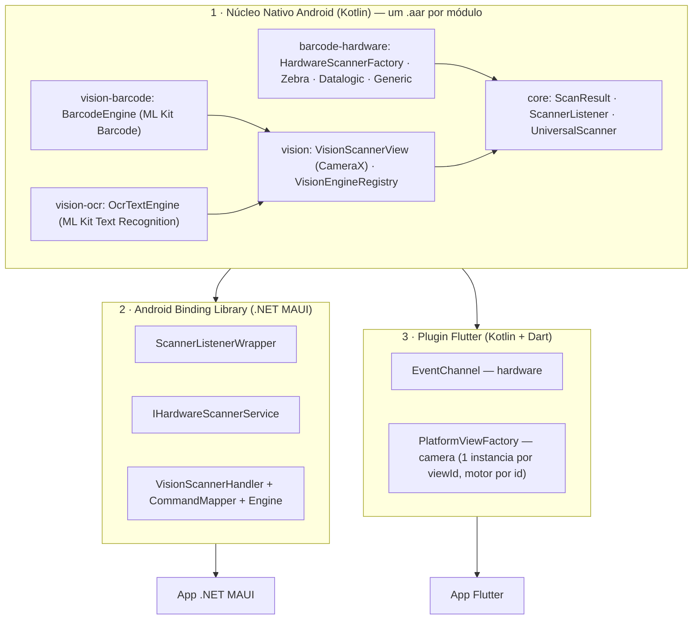

# scanner-vc-ia-rfid

**Biblioteca Universal de Captura de Dados.**

O `ScannerVcIaRfid` unifica, sob uma única fachada nativa em Kotlin, duas formas completamente diferentes de capturar código de barras em um dispositivo Android corporativo:

- **Hardware físico** — coletores Zebra (perfis DataWedge) e Datalogic (Intent Wedge), além de qualquer leitor genérico baseado em Intent, todos escutados via `BroadcastReceiver`.
- **Câmera** — leitura óptica via **CameraX** + **Google ML Kit Barcode Scanning**, quando o aparelho não tem um leitor dedicado.

O time de app nunca precisa saber qual fabricante está por trás do coletor, nem lidar com CameraX diretamente. O núcleo é dividido em módulos Gradle publicados como `.aar` independentes: o app leva só os recursos que usar. Os módulos são consumidos de forma nativa, via **.NET MAUI** (Android Binding Library) ou via **Flutter** (Platform Channels).

---

## Sumário

- [Arquitetura do Projeto (A Tríade)](#arquitetura-do-projeto-a-tríade)
  - [Módulos nativos](#módulos-nativos)
  - [Camada Nativa (Kotlin)](#1-camada-nativa-kotlin)
  - [Camada .NET MAUI](#2-camada-net-maui-android-binding-library)
  - [Camada Flutter](#3-camada-flutter-plugin)
- [Estrutura do repositório](#estrutura-do-repositório)
- [Build dos módulos nativos](#build-dos-módulos-nativos)
- [Guia rápido de integração](#guia-rápido-de-integração)
  - [Requisito global — permissão de câmera](#requisito-global--permissão-de-câmera)
  - [MAUI](#maui)
  - [Flutter](#flutter)

---

## Arquitetura do Projeto (A Tríade)



### Módulos nativos

| Módulo (`com.scannervciarfid:<módulo>`) | Conteúdo | Depende de |
|---|---|---|
| `core` | `ScanResult`, `ScannerListener`, `UniversalScanner` | — |
| `barcode-hardware` | `HardwareScannerFactory`, adapters Zebra, Datalogic, Honeywell, Newland, Urovo e Intent genérico | `core` |
| `vision` | `VisionScannerView` (CameraX), `VisionEngineAnalyzer`, `VisionEngineRegistry`, overlay | `core`, CameraX |
| `vision-barcode` | `BarcodeEngine` (id `"barcode"`) | `vision`, ML Kit Barcode |
| `vision-ocr` | `OcrTextEngine` (id `"ocr"`) | `vision`, ML Kit Text Recognition |
| `code-scanner` | `GoogleCodeScanner` (leitura única, sem permissão de câmera) | `core`, Google Play Services |

Cada recurso novo (NFC, RFID UHF, IA) entra como um módulo próprio, que depende de `core`. O módulo `vision` não conhece os motores: cada motor se registra no `VisionEngineRegistry` (ex.: `BarcodeEngine.register()`), e as pontes escolhem o motor pelo id.

### 1. Camada Nativa (Kotlin)

Os módulos nativos são o único lugar do ecossistema que conhece hardware de verdade. Duas decisões de design sustentam tudo o que vem depois:

**SDKs proprietários como `compileOnly`.** Os SDKs da Zebra (EMDK) e da Datalogic são declarados assim no `build.gradle.kts` do módulo `barcode-hardware`:

```kotlin
compileOnly(files(rootProject.file("libs/EMDK.jar")))
compileOnly(files(rootProject.file("libs/DatalogicSDK.jar")))
```

Esses `.jar` já existem no firmware dos coletores físicos — declará-los como `implementation` embarcaria binários redundantes no `.aar`, inflando o pacote e arriscando conflito de classes com a versão que o próprio aparelho carrega. Na prática, nem é preciso tocar diretamente nessas APIs proprietárias: os adapters de hardware (`ZebraDataWedgeScanner`, `DatalogicIntentScanner`) escutam apenas o resultado da leitura via `BroadcastReceiver`/Intents padrão do Android (perfis DataWedge, Intent Wedge da Datalogic).

**API pública sem recursos exclusivos do Kotlin.** `ScannerListener`, `UniversalScanner`, `ScanResult` e `VisionEngineProvider` são, propositalmente, Kotlin "sem açúcar": interfaces com métodos tradicionais (`onScanSuccess`/`onScanError`) em vez de `Flow`, nenhuma `suspend fun` pública, nenhuma `inline fun` ou lambda complexo na assinatura pública, e um `data class` com propriedades `String` simples. Geradores de binding (o `class-parse` do .NET Android SDK, o Platform Channel do Flutter) interpretam interfaces e enums Java/Kotlin clássicos sem problema — mas não sabem o que fazer com corrotinas. Restringir a API pública a listeners e classes de dados primitivas é o que permite o **mesmo** `.aar` virar consumível, de forma idêntica, por C# e por Dart.

### 2. Camada .NET MAUI (Android Binding Library)

O binding traduz o `.aar` em tipos C# (`Com.Scannervciarfid.*`), e a camada `ScannerVcIaRfid.Maui` empacota isso em abstrações idiomáticas:

- **`ScannerListenerWrapper`** — herda `Java.Lang.Object` e implementa `IScannerListener` (gerado a partir de `ScannerListener`), traduzindo os callbacks JNI em `EventHandler<ScanResultEventArgs>`/`EventHandler<ScanErrorEventArgs>` usando POCOs puros. Nada acima dele precisa referenciar tipos Java.
- **`IHardwareScannerService`** — interface cross-platform injetada via DI como `Singleton` (o leitor físico é um recurso global do aparelho, não algo por-página). A implementação Android (`HardwareScannerService`) é **idempotente** em `Initialize()` — proteção necessária porque `OnAppearing()` pode rodar várias vezes ao longo da vida da página, e registrar o `BroadcastReceiver` nativo duas vezes sem `Release()` no meio derruba o app.
- **`VisionScanner.Engine`** — `BindableProperty` com o id do motor (`VisionEngines.Barcode`, `VisionEngines.Ocr`). O `PropertyMapper` busca o motor no `VisionEngineRegistry` nativo e o aplica na view. A troca funciona com a câmera ligada.
- **`VisionScannerHandler` + `CommandMapper` (Strict Gating)** — o `ConnectHandler()` do handler **não** inicia a câmera automaticamente. `VisionScanner.StartCamera()` apenas invoca `Handler?.Invoke(nameof(StartCamera))`; um `CommandMapper<VisionScanner, VisionScannerHandler>` estático intercepta esse comando e só então chama `PlatformView.StartCamera()`. Isso elimina a condição de corrida entre o bind do CameraX e o diálogo assíncrono de permissão do usuário — a câmera só liga quando o app explicitamente mandar, depois de confirmar a permissão.

### 3. Camada Flutter (Plugin)

O plugin (`scanner_vc_ia_rfid_flutter`) expõe as duas mesmas vias através dos dois mecanismos de comunicação canônicos do Flutter:

- **`EventChannel` para o hardware** — `HardwareScannerStreamHandler` inicializa e liga o `UniversalScanner` nativo em `onListen`, convertendo cada `ScanResult` em `Map<String, String>` e emitindo via `events.success(...)`. `onCancel` só chama `stop()` (não `release()`) — o leitor físico só é de fato liberado quando o plugin inteiro é desanexado do engine, não a cada vez que a tela Dart para de escutar o stream.
- **`PlatformView` com instâncias isoladas por `viewId`** — cada `AndroidView` no lado Dart gera uma instância própria de `VisionScannerPlatformView`, com seu próprio `MethodChannel` nomeado `"<view_type>_<viewId>"`. Isso evita que múltiplas câmeras simultâneas na mesma árvore de widgets cruzem eventos entre si — cada preview só recebe os comandos (`startCamera`, `setEngine`) e callbacks (`onScanSuccess`/`onScanError`) da sua própria instância nativa.
- **Motor por id** — `VisionScannerWidget(engine: VisionEngines.ocr)` envia o id nos `creationParams`. Mudar `engine` depois chama `setEngine`, sem recriar a câmera.
- **Dependências via Maven** — o `android/build.gradle` do plugin lê os módulos do repositório Maven gerado por `./gradlew publish`. O POM de cada módulo traz CameraX e ML Kit de forma transitiva.

---

## Estrutura do repositório

```
scanner-vc-ia-rfid/
├── build.gradle.kts                       # Raiz: configuração comum, maven-publish, exportMauiAars
├── settings.gradle.kts                    # Lista dos módulos
├── gradle/libs.versions.toml              # Versões compartilhadas (AGP, CameraX, ML Kit)
├── core/                                  # Contratos: ScanResult, ScannerListener, UniversalScanner
├── barcode-hardware/                      # HardwareScannerFactory + adapters de leitor físico
├── vision/                                # VisionScannerView (CameraX) + registro de motores
├── vision-barcode/                        # BarcodeEngine (ML Kit Barcode)
├── vision-ocr/                            # OcrTextEngine (ML Kit Text Recognition)
├── sample/                                # App Android nativo de exemplo
│
├── dotnet/                                # Ponte .NET MAUI
│   ├── ScannerVcIaRfid.Android.Binding/     # Android Binding Library (consome o .aar)
│   ├── ScannerVcIaRfid.Maui/                # Wrappers, services, controls, handlers (Strict Gating)
│   └── ScannerVcIaRfid.Maui.Sample/         # App de exemplo
│
└── flutter/                               # Ponte Flutter
    └── scanner_vc_ia_rfid_flutter/
        ├── android/                         # Plugin nativo (EventChannel + PlatformView)
        ├── lib/                             # API Dart pública
        └── example/                         # App de exemplo
```

---

## Build dos módulos nativos

Rode os comandos na raiz do repositório:

1. Gere o repositório Maven local (usado pelo plugin Flutter):

   ```bash
   ./gradlew publish
   ```

   A saída fica em `build/maven-repo`, com um `.aar`, um POM e um `.module` por módulo.

2. Gere os `.aar` para a binding .NET MAUI:

   ```bash
   ./gradlew exportMauiAars
   ```

   A task copia `scanner-vc-ia-rfid-<módulo>.aar` para `dotnet/ScannerVcIaRfid.Android.Binding/Jars/`.

Repita os dois passos sempre que alterar o código Kotlin. A versão publicada fica em `VERSION_NAME` (`gradle.properties`).

## Guia rápido de integração

### Requisito global — permissão de câmera

> [!WARNING]
> Todo app hospedeiro (MAUI ou Flutter) que use a captura via câmera **precisa** declarar, no seu próprio `AndroidManifest.xml`:
>
> ```xml
> <uses-permission android:name="android.permission.CAMERA" />
> ```
>
> Isso **não** basta sozinho: a partir do Android 6 (API 23), a permissão também precisa ser solicitada **em tempo de execução**, antes de iniciar a câmera — ambos os quickstarts abaixo mostram como. Sem o request em runtime, o bind do CameraX falha (de forma controlada, sem crash — o núcleo Kotlin já captura a `SecurityException` e reporta via `onScanError`), mas a câmera simplesmente não funciona.

### MAUI

**1. Gere os `.aar`** com `./gradlew exportMauiAars` (ver [Build dos módulos nativos](#build-dos-módulos-nativos)).

**2. Registro em `MauiProgram.cs`:**

```csharp
builder.Services.AddSingleton<IHardwareScannerService, HardwareScannerService>();

builder.ConfigureMauiHandlers(handlers =>
{
    handlers.AddHandler<VisionScanner, VisionScannerHandler>();
});
```

**3. XAML** — `Engine` é opcional (padrão: `barcode`):

```xml
<controls:VisionScanner x:Name="CameraScannerView"
                        Engine="ocr"
                        HeightRequest="300" />
```

**4. Code-behind — permissão em runtime + Strict Gating:**

```csharp
protected override async void OnAppearing()
{
    base.OnAppearing();

    _hardwareScanner.Initialize();
    _hardwareScanner.ScanSucceeded += OnHardwareScanSucceeded;

    var granted = await EnsureCameraPermissionAsync();
    if (granted)
    {
        // A câmera só liga aqui — o Handler nunca inicia sozinho.
        CameraScannerView.StartCamera();
    }
}

private static async Task<bool> EnsureCameraPermissionAsync()
{
    var status = await Permissions.CheckStatusAsync<Permissions.Camera>();
    if (status != PermissionStatus.Granted)
    {
        status = await Permissions.RequestAsync<Permissions.Camera>();
    }
    return status == PermissionStatus.Granted;
}
```

**5. Leitura única com o Google Code Scanner** (opcional, exige Play Services, sem permissão de câmera):

```csharp
builder.Services.AddSingleton<ICodeScannerService, CodeScannerService>();

var result = await _codeScanner.ScanAsync(); // null = usuário cancelou
```

**6. Coletor sem adapter próprio** (Chainway, Sunmi, Seuic...): configure a saída Intent no aparelho e informe a mesma action e o mesmo extra:

```csharp
_hardwareScanner.UseGenericIntent("com.minhaempresa.SCAN", "data");
```

Exemplo completo em [`dotnet/ScannerVcIaRfid.Maui.Sample`](dotnet/ScannerVcIaRfid.Maui.Sample).

### Flutter

**1. Publique os módulos** com `./gradlew publish` (ver [Build dos módulos nativos](#build-dos-módulos-nativos)). O plugin lê `build/maven-repo` deste repositório. Para outro local, defina `scannerVcIaRfidMavenRepo` no `gradle.properties` do app.

**2. Escute o leitor de hardware como um `Stream`:**

```dart
StreamSubscription<ScanResult>? _hardwareSubscription;

@override
void initState() {
  super.initState();
  _hardwareSubscription =
      ScannerVcIaRfidHardware.instance.onBarcodeScanned.listen(_handleScanResult);
}

@override
void dispose() {
  _hardwareSubscription?.cancel();   // evita vazamento de memória
  super.dispose();
}
```

**3. Peça a permissão de câmera antes de construir o widget:**

```dart
final status = await Permission.camera.request();
```

**4. Embuta a câmera nativa — sempre dentro de um container com altura explícita:**

```dart
SizedBox(
  height: 300,
  child: status.isGranted
      ? VisionScannerWidget(
          engine: VisionEngines.barcode, // ou VisionEngines.ocr
          onScan: _handleScanResult,
          onScanError: (message) => debugPrint('Erro: $message'),
        )
      : const Center(child: Text('Permissão de câmera negada.')),
)
```

`PlatformView` não tem tamanho intrínseco no Flutter: sem altura definida, o `AndroidView` renderiza com altura zero.

**5. Leitura única com o Google Code Scanner** (opcional, exige Play Services, sem permissão de câmera):

```dart
final result = await ScannerVcIaRfidCodeScanner.instance.scan(); // null = cancelado
```

**6. Coletor sem adapter próprio** (Chainway, Sunmi, Seuic...): configure a saída Intent no aparelho e informe a mesma action e o mesmo extra:

```dart
await ScannerVcIaRfidHardware.instance.useGenericIntent(
  intentAction: 'com.minhaempresa.SCAN',
  dataExtraKey: 'data',
);
```

Exemplo completo em [`flutter/scanner_vc_ia_rfid_flutter/example`](flutter/scanner_vc_ia_rfid_flutter/example).

---

## Origem dos dados de leitura (`sourceEngine`)

| `sourceEngine` | Origem |
|---|---|
| `Zebra_DataWedge` | Perfil DataWedge de coletores Zebra. `format` vem do `label_type` (ex.: `EAN13`) |
| `Datalogic_Intent` | Intent Wedge de coletores Datalogic |
| `Honeywell_Intent` | Intent API de coletores Honeywell |
| `Newland_Intent` | Saída por broadcast de coletores Newland |
| `Urovo_Intent` | Saída Intent de coletores Urovo |
| `Generic_Intent` | Leitor de Intent genérico (`createGeneric` / `UseGenericIntent` / `useGenericIntent`) |
| `MLKit_Barcode` | Código de barras lido pela câmera (CameraX + ML Kit Barcode Scanning) |
| `Google_CodeScanner` | Código de barras lido pela tela do Google Code Scanner |
| `MLKit_OCR` | Texto lido pela câmera (CameraX + ML Kit Text Recognition). `value` é um JSON com `fullText` e `blocks` |

A câmera não envia um resultado a cada frame. Um valor igual ao anterior só é enviado de novo depois de 1,5 s fora do quadro. No OCR, o intervalo mínimo entre dois resultados é de 1 s.

## Configuração dos coletores físicos

- **Zebra:** em `initialize()`, a biblioteca envia um `SET_CONFIG` ao DataWedge. Esse comando cria o perfil `ScannerVcIaRfid_<package>` (se ele não existir), associa o perfil ao app, liga a saída Intent (broadcast, action `com.scannervciarfid.zebra.SCAN`) e desliga a saída Keystroke. Se um MDM já associou o app a outro perfil, configure nesse perfil a mesma action, com entrega por broadcast.
- **Datalogic:** ative o Intent Wedge nas configurações de Scanner do aparelho, com entrega por broadcast, action `com.datalogic.decodewedge.decode_action` e categoria `com.datalogic.decodewedge.decode_category`. Alguns modelos usam outros valores de fábrica.
- **Honeywell:** em `start()`, a biblioteca reivindica o leitor (`ACTION_CLAIM_SCANNER`) com a saída Data Intent na action `com.scannervciarfid.honeywell.SCAN`. Em `stop()`, ela devolve o leitor (`ACTION_RELEASE_SCANNER`). Se o firmware não aceitar o claim, configure o Data Intent no perfil do aparelho e use o leitor genérico.
- **Newland:** em `initialize()`, a biblioteca envia `ACTION_BAR_SCANCFG` com `EXTRA_SCAN_MODE = 3` (saída por broadcast). A leitura chega em `nlscan.action.SCANNER_RESULT`, extra `SCAN_BARCODE1`.
- **Urovo:** coloque o modo de saída em "Intent" (Configurações > Scanner ou ScanWedge). A biblioteca escuta os valores de fábrica: action `android.intent.ACTION_DECODE_DATA`, extra `barcode_string`.
- **Outros (Chainway, Sunmi, Seuic...):** configure a saída Intent no app do aparelho (ex.: Keyboard Emulator, InfoWedge) e use o leitor genérico com a mesma action e o mesmo extra.

> [!NOTE]
> Os adapters Honeywell, Newland e Urovo seguem a documentação dos fabricantes, mas ainda não foram testados em aparelho. Os nomes de action e extra podem mudar entre firmwares.

## Requisitos

| Componente | Versão mínima |
|---|---|
| `compileSdk` (módulos nativos) | 36 |
| `minSdk` (módulos nativos) | 24 |
| Android Gradle Plugin | 9.3.1 |
| CameraX | 1.6.1 |
| Google ML Kit Barcode Scanning | 17.3.0 |
| Google Play Services Code Scanner | 16.1.0 |
| Google ML Kit Text Recognition | 16.0.1 |
| .NET | 10.0 (`net10.0-android`) |
| Flutter | 3.19+ / Dart 3.3+ |
