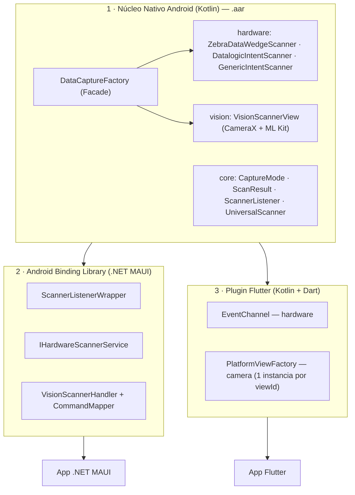

# OpenSystemScanner

**Biblioteca Universal de Captura de Dados.**

O `OpenSystemScanner` unifica, sob uma única fachada nativa em Kotlin, duas formas completamente diferentes de capturar código de barras em um dispositivo Android corporativo:

- **Hardware físico** — coletores Zebra (perfis DataWedge) e Datalogic (Intent API), além de qualquer leitor genérico baseado em Intent, todos escutados via `BroadcastReceiver`.
- **Câmera** — leitura óptica via **CameraX** + **Google ML Kit Barcode Scanning**, quando o aparelho não tem um leitor dedicado.

O time de app nunca precisa saber qual fabricante está por trás do coletor, nem lidar com CameraX diretamente: tudo passa por um único ponto de entrada (`DataCaptureFactory`), consumido de forma nativa, via **.NET MAUI** (Android Binding Library) ou via **Flutter** (Platform Channels).

---

## Sumário

- [Arquitetura do Projeto (A Tríade)](#arquitetura-do-projeto-a-tríade)
  - [Camada Nativa (Kotlin)](#1-camada-nativa-kotlin)
  - [Camada .NET MAUI](#2-camada-net-maui-android-binding-library)
  - [Camada Flutter](#3-camada-flutter-plugin)
- [Estrutura do repositório](#estrutura-do-repositório)
- [Guia rápido de integração](#guia-rápido-de-integração)
  - [Requisito global — permissão de câmera](#requisito-global--permissão-de-câmera)
  - [MAUI](#maui)
  - [Flutter](#flutter)

---

## Arquitetura do Projeto (A Tríade)



### 1. Camada Nativa (Kotlin)

O módulo `com.opensystemscanner` é o único lugar do ecossistema que conhece hardware de verdade. Duas decisões de design sustentam tudo o que vem depois:

**SDKs proprietários como `compileOnly`.** Os SDKs da Zebra (EMDK) e da Datalogic são declarados assim no `build.gradle.kts` do núcleo:

```kotlin
compileOnly(files("libs/EMDK.jar"))
compileOnly(files("libs/DatalogicSDK.jar"))
```

Esses `.jar` já existem no firmware dos coletores físicos — declará-los como `implementation` embarcaria binários redundantes no `.aar`, inflando o pacote e arriscando conflito de classes com a versão que o próprio aparelho carrega. Na prática, nem é preciso tocar diretamente nessas APIs proprietárias: os adapters de hardware (`ZebraDataWedgeScanner`, `DatalogicIntentScanner`) escutam apenas o resultado da leitura via `BroadcastReceiver`/Intents padrão do Android (perfis DataWedge, Intent API da Datalogic).

**API pública sem recursos exclusivos do Kotlin.** `ScannerListener`, `UniversalScanner`, `ScanResult` e `CaptureMode` são, propositalmente, Kotlin "sem açúcar": interfaces com métodos tradicionais (`onScanSuccess`/`onScanError`) em vez de `Flow`, nenhuma `suspend fun` pública, nenhuma `inline fun` ou lambda complexo na assinatura pública, e um `data class` com propriedades `String` simples. Geradores de binding (o `class-parse` do .NET Android SDK, o Platform Channel do Flutter) interpretam interfaces e enums Java/Kotlin clássicos sem problema — mas não sabem o que fazer com corrotinas. Restringir a API pública a listeners e classes de dados primitivas é o que permite o **mesmo** `.aar` virar consumível, de forma idêntica, por C# e por Dart.

### 2. Camada .NET MAUI (Android Binding Library)

O binding traduz o `.aar` em tipos C# (`Com.Opensystemscanner.*`), e a camada `OpenSystemScanner.Maui` empacota isso em abstrações idiomáticas:

- **`ScannerListenerWrapper`** — herda `Java.Lang.Object` e implementa `IScannerListener` (gerado a partir de `ScannerListener`), traduzindo os callbacks JNI em `EventHandler<ScanResultEventArgs>`/`EventHandler<ScanErrorEventArgs>` usando POCOs puros. Nada acima dele precisa referenciar tipos Java.
- **`IHardwareScannerService`** — interface cross-platform injetada via DI como `Singleton` (o leitor físico é um recurso global do aparelho, não algo por-página). A implementação Android (`HardwareScannerService`) é **idempotente** em `Initialize()` — proteção necessária porque `OnAppearing()` pode rodar várias vezes ao longo da vida da página, e registrar o `BroadcastReceiver` nativo duas vezes sem `Release()` no meio derruba o app.
- **`VisionScannerHandler` + `CommandMapper` (Strict Gating)** — o `ConnectHandler()` do handler **não** inicia a câmera automaticamente. `VisionScanner.StartCamera()` apenas invoca `Handler?.Invoke(nameof(StartCamera))`; um `CommandMapper<VisionScanner, VisionScannerHandler>` estático intercepta esse comando e só então chama `PlatformView.StartCamera()`. Isso elimina a condição de corrida entre o bind do CameraX e o diálogo assíncrono de permissão do usuário — a câmera só liga quando o app explicitamente mandar, depois de confirmar a permissão.

### 3. Camada Flutter (Plugin)

O plugin (`opensystemscanner_flutter`) expõe as duas mesmas vias através dos dois mecanismos de comunicação canônicos do Flutter:

- **`EventChannel` para o hardware** — `HardwareScannerStreamHandler` inicializa e liga o `UniversalScanner` nativo em `onListen`, convertendo cada `ScanResult` em `Map<String, String>` e emitindo via `events.success(...)`. `onCancel` só chama `stop()` (não `release()`) — o leitor físico só é de fato liberado quando o plugin inteiro é desanexado do engine, não a cada vez que a tela Dart para de escutar o stream.
- **`PlatformView` com instâncias isoladas por `viewId`** — cada `AndroidView` no lado Dart gera uma instância própria de `VisionScannerPlatformView`, com seu próprio `MethodChannel` nomeado `"<view_type>_<viewId>"`. Isso evita que múltiplas câmeras simultâneas na mesma árvore de widgets cruzem eventos entre si — cada preview só recebe os comandos (`startCamera`) e callbacks (`onScanSuccess`/`onScanError`) da sua própria instância nativa.

---

## Estrutura do repositório

```
opensystemscanner/
├── build.gradle.kts                      # Módulo Android Library nativo
├── src/main/
│   ├── AndroidManifest.xml               # Permissão + <uses-feature required="false">
│   └── kotlin/com/opensystemscanner/
│       ├── DataCaptureFactory.kt          # Facade / ponto de entrada único
│       ├── core/                          # Contratos: CaptureMode, ScanResult, ScannerListener, UniversalScanner
│       ├── hardware/                      # Adapters de leitor físico
│       └── vision/                        # VisionScannerView (CameraX + ML Kit)
│
├── dotnet/                                # Ponte .NET MAUI
│   ├── OpenSystemScanner.Android.Binding/   # Android Binding Library (consome o .aar)
│   ├── OpenSystemScanner.Maui/              # Wrappers, services, controls, handlers (Strict Gating)
│   └── OpenSystemScanner.Maui.Sample/       # App de exemplo
│
└── flutter/                               # Ponte Flutter
    └── opensystemscanner_flutter/
        ├── android/                         # Plugin nativo (EventChannel + PlatformView)
        ├── lib/                             # API Dart pública
        └── example/                         # App de exemplo
```

---

## Guia rápido de integração

### Requisito global — permissão de câmera

> [!WARNING]
> Todo app hospedeiro (MAUI ou Flutter) que use a captura via câmera **precisa** declarar, no seu próprio `AndroidManifest.xml`:
>
> ```xml
> <uses-permission android:name="android.permission.CAMERA" />
> ```
>
> Isso **não** basta sozinho: a partir do Android 6 (API 23), a permissão também precisa ser solicitada **em tempo de execução**, antes de iniciar a câmera — ambos os quickstarts abaixo mostram como. Sem o request em runtime, o bind do CameraX falha (de forma controlada, sem crash — o núcleo Kotlin já captura a `SecurityException` e reporta via `onScanError`), mas a câmera simplesmente não funciona.

### MAUI

**1. Registro em `MauiProgram.cs`:**

```csharp
builder.Services.AddSingleton<IHardwareScannerService, HardwareScannerService>();

builder.ConfigureMauiHandlers(handlers =>
{
    handlers.AddHandler<VisionScanner, VisionScannerHandler>();
});
```

**2. XAML:**

```xml
<controls:VisionScanner x:Name="CameraScannerView" HeightRequest="300" />
```

**3. Code-behind — permissão em runtime + Strict Gating:**

```csharp
protected override async void OnAppearing()
{
    base.OnAppearing();

    _hardwareScanner.Initialize();
    _hardwareScanner.ScanSucceeded += OnHardwareScanSucceeded;

    var granted = await EnsureCameraPermissionAsync();
    if (granted)
    {
        // A câmera só liga aqui — o Handler nunca inicia sozinho.
        CameraScannerView.StartCamera();
    }
}

private static async Task<bool> EnsureCameraPermissionAsync()
{
    var status = await Permissions.CheckStatusAsync<Permissions.Camera>();
    if (status != PermissionStatus.Granted)
    {
        status = await Permissions.RequestAsync<Permissions.Camera>();
    }
    return status == PermissionStatus.Granted;
}
```

Exemplo completo em [`dotnet/OpenSystemScanner.Maui.Sample`](dotnet/OpenSystemScanner.Maui.Sample).

### Flutter

**1. Escute o leitor de hardware como um `Stream`:**

```dart
StreamSubscription<ScanResult>? _hardwareSubscription;

@override
void initState() {
  super.initState();
  _hardwareSubscription =
      OpenSystemScannerHardware.instance.onBarcodeScanned.listen(_handleScanResult);
}

@override
void dispose() {
  _hardwareSubscription?.cancel();   // evita vazamento de memória
  super.dispose();
}
```

**2. Peça a permissão de câmera antes de construir o widget:**

```dart
final status = await Permission.camera.request();
```

**3. Embuta a câmera nativa — sempre dentro de um container com altura explícita:**

```dart
SizedBox(
  height: 300,
  child: status.isGranted
      ? VisionScannerWidget(
          onScan: _handleScanResult,
          onScanError: (message) => debugPrint('Erro: $message'),
        )
      : const Center(child: Text('Permissão de câmera negada.')),
)
```

`PlatformView` não tem tamanho intrínseco no Flutter: sem altura definida, o `AndroidView` renderiza com altura zero.

Exemplo completo em [`flutter/opensystemscanner_flutter/example`](flutter/opensystemscanner_flutter/example).

---

## Origem dos dados de leitura (`sourceEngine`)

| `sourceEngine` | Origem |
|---|---|
| `Zebra_DataWedge` | Perfil DataWedge de coletores Zebra |
| `Datalogic_Intent` | Intent API de coletores Datalogic |
| `Generic_Intent` | Fallback configurável para qualquer coletor baseado em Intent |
| `MLKit_Camera` | Câmera do aparelho via CameraX + Google ML Kit |

## Requisitos

| Componente | Versão mínima |
|---|---|
| `compileSdk` (núcleo Android) | 36 |
| `minSdk` (núcleo Android) | 24 |
| CameraX | 1.3.4 |
| Google ML Kit Barcode Scanning | 17.3.0 |
| .NET | 8.0 (`net8.0-android`) |
| Flutter | 3.19+ / Dart 3.3+ |
